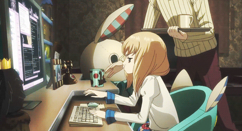

 

 

**I'm a computer science student specialising in cybersecurity, with a focus on Python and Java, currently sharpening my skills through hands-on projects and consistent practice. I believe in learning by building — most of my repositories reflect real problems I explored, experiments I ran, or concepts I tried to understand more deeply. Always growing. Always shipping.**

 

&nbsp;&nbsp;&nbsp;&nbsp;&nbsp;&nbsp;&nbsp;&nbsp;

  

 

  

