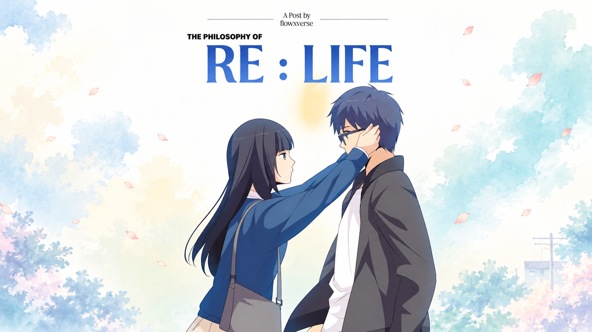

# Aditya Vishwakarma

**Computer Science student · Cybersecurity · Python & Java**

 

 

## About

I'm a computer science student specialising in cybersecurity, with a focus on Python and Java, currently sharpening my skills through hands-on projects and consistent practice.

I believe in learning by building. Most of my repositories reflect real problems I explored, experiments I ran, or concepts I tried to understand more deeply. Always growing. Always shipping.

## Currently Working On

**Shizukasa** — an end-to-end encrypted (E2EE) web chat app.

